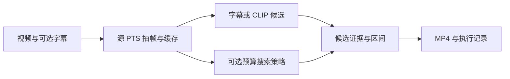

# QuerySeek-VideoAgent

**自然语言视频检索、证据定位与预算约束下的搜索策略学习。**

本项目将视频预处理、CLIP/字幕检索、可执行搜索动作和视频剪辑连接起来，并用真实 QLoRA 实验研究错误搜索起点下的恢复能力。
当前实证范围是 **QVHighlights 内部来源隔离的时序定位**；真实长视频问答、RL 和可靠负查询拒答仍待验证。

## 已完成的工作

- **可运行系统**：FFmpeg / PySceneDetect 预处理、BM25 与 OpenCLIP 检索、CLI、Streamlit、片段导出。
- **可训练策略**：深入、回退、切换分支、补充观察、回答/弃答；模型只引用实际已观察的源时间帧。
- **真实微调**：Qwen3-VL-8B，单张 RTX 4090，语言层 QLoRA；384 训练来源、1536 弱监督轨迹、4050 动作状态。
- **可追查实验**：开发集选模、来源隔离确认、失败保留分母、成本记录、来源配对置信区间。
- **离线验证**：合成 fixture 与确定性 Mock；无密钥和 GPU 也能运行检索、剪辑及工程测试。

原创工作范围是统一时间/证据接口、检索与候选规则、搜索状态机、训练数据适配及实验诊断。
骨干模型、QLoRA 和第三方网络均为复用；回退与绕路轨迹参考 VTS，不声称完整论文复现。

## 核心结果：必须连同强基线阅读

以下为 **2026-10-21 归档实验**，并非本次发布重新训练；同一 128 来源内部确认集，视频约 2.5 分钟。

| 模型 / 策略 | R1@0.5 | R1@0.7 | 平均生成次数 / 任务 |
|---|---:|---:|---:|
| NF4 基座，固定 16 帧 | 30.47% | 13.28% | 1.000 |
| SFT，固定 16 帧 | **64.84%** | 36.72% | **1.000** |
| NF4 基座，允许回退 | 14.06% | 5.08% | 2.066 |
| SFT，只能深入 | 30.86% | 17.19% | 2.879 |
| SFT，允许回退 | 57.42% | **37.50%** | 3.141 |

回退微调相对同精度基座：R1@0.5 **+43.36pp**，来源配对 95% CI **[+35.94,+51.17]pp**；错误起点任务恢复 **3/80 → 43/80**。
**固定 16 帧 SFT 的 R1@0.5 更高且调用更少，因此不能宣称搜索整体优于固定观察。** 禁止回退组是动作消融，没有独立训练最优前向模型。相同帧上限也不代表相同实际计算量。

聚合原始数据：[基座](results/confirmation_base.json)、[SFT](results/confirmation_sft.json)、[来源与源码 SHA](results/provenance.json)。
更多口径、成本和局限见 [实验说明](docs/RESULTS.md)。该划分属于官方 train 内部来源留出，部分数据此前用于其他研究，不是外部盲测或官方 test 排行榜。

## 快速开始：无密钥 / 无 GPU

需要 Python 3.11+、FFmpeg 与 ffprobe。以下命令在仓库根目录执行。

```bash
python -m venv .venv
# Windows: .venv\Scripts\activate
# Linux/macOS: source .venv/bin/activate
python -m pip install -e ".[dev]"
python scripts/make_synthetic_fixture.py
python -m queryseek.cli doctor
python -m queryseek.cli ingest --video assets/demo/sample.mp4 --srt assets/demo/sample.srt --mock
python -m queryseek.cli search --video-id sample --query "architecture" --strategy curve --mock
python -m queryseek.cli run --video-id sample --query "architecture" --strategy curve --mock --render --target-seconds 10
```

运行结果写入 `outputs/`。合成视频与 Mock **只验证工程流程，不是算法成绩**。
`--target-seconds` 是选段目标，不是严格截断上限；完整候选可能更长，实际导出范围以 manifest 为准。

网页演示：

```bash
python -m pip install -e ".[agent]"
python -m streamlit run app/streamlit_app.py
```

网页选择 Mock，可使用刚生成的样本。真实 CLIP 检索另装 `.[embedding]`，首次可能下载权重。
VLM 服务参数使用 `.env.example` 中的环境变量；请自行选择有图像输入能力的兼容服务。

## 结构与接口



所有外部时间均为浮点秒，区间 `[start_sec, end_sec)`，满足 `0 <= start < end <= duration`。
管线 v2 使用源 PTS 和与权重匹配的 CLIP 激活配置；旧 v1 成绩不混入当前结果。

| 目录 | 内容 |
|---|---|
| `queryseek/` | 时间契约、预处理、检索、搜索策略、模型接口和导出 |
| `scripts/` | 合成 fixture、评测适配与历史研究工具 |
| `tests/` | 可公开的合成 / Mock 回归测试 |
| `configs/` | 通用参数及研究配置；研究路径需要自行准备 |
| `results/` | 已有实验的聚合指标、来源哈希和发布验证 |
| `docs/` | 实验边界、复现说明和后续研究规划 |

SFT 策略仍是研究脚本入口，尚未成为普通 CLI 的默认在线后端。研究脚本依赖合法获得的媒体、基座与冻结输入包；公开仓库不包含这些资产。

## 测试与复现边界

```bash
python -m pip install -e ".[dev,agent,research]"
python -m pytest -q
```

本地历史完整套件为 450 passed / 2 skipped。公开快照移除了具体病例复核配置和依赖它们的三份测试文件，发布测试另行报告在 [RELEASE_VALIDATION.md](docs/RELEASE_VALIDATION.md)，不能混称为相同套件。
GitHub Actions 运行较小的核心 Mock 检查，不代表完整模型或 GPU 验证。

参见 [复现指南](docs/REPRODUCIBILITY.md)。原始数据、标注、权重、真实图像与私人运维记录未分发；clone 后能验证工程闭环，完整训练需要另行准备输入。

## 接下来研究什么

优先建立全局直接回答、检索固定流程与 VTS 强基线，研究**继续观察的预期收益能否支持更好的补看与停止决策**。
重点比较联合答案/证据质量与真实成本；当前没有新方法收益声明。详见 [研究规划](docs/RESEARCH_ROADMAP.md)。

## 许可与引用

本项目代码采用 [MIT License](LICENSE)。第三方 vendored UniVTG 保留其原始 MIT 声明；数据、模型权重和外部工具各自适用其许可，见 [THIRD_PARTY.md](THIRD_PARTY.md)。
参考 [VideoAgent](https://arxiv.org/abs/2403.10517)、[VideoTree](https://arxiv.org/abs/2405.19209)、[VideoMind](https://arxiv.org/abs/2503.13444)、[VTS](https://arxiv.org/abs/2607.16189)；项目并非这些工作的官方实现。
