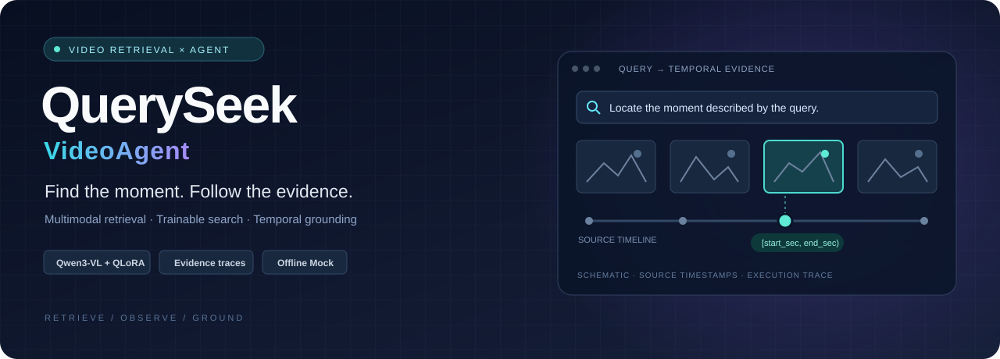
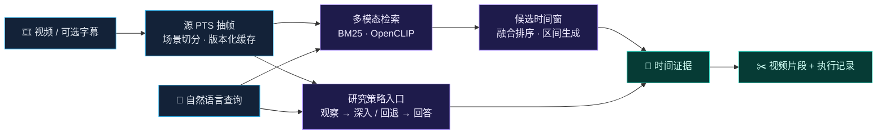

<div align="center">



**用一句话找到视频中的关键时刻，让每一次搜索都有迹可循。**

[](https://github.com/wubuxy/QuerySeek-VideoAgent/actions/workflows/mock-tests.yml)
[](pyproject.toml)
[](configs/agent_sft_v1.json)
[](docs/RELEASE_VALIDATION.md)
[](LICENSE)

[项目亮点](#highlights) · [系统架构](#architecture) · [实验结果](#results) · [快速开始](#quickstart) · [复现指南](docs/REPRODUCIBILITY.md)

</div>

<br />

QuerySeek 将自然语言查询转换为带时间戳的视频证据与可导出的片段。项目覆盖 **离线建库 → 多模态检索 → 预算内主动搜索 → 证据定位 → 视频剪辑**，并实现了 Qwen3-VL 的搜索策略微调与来源隔离评测。

<a id="highlights"></a>
## ✦ 我们做了什么

<table>
<tr>
<td width="50%" valign="top">
<h3>🔎 从查询到视频片段</h3>
<p>组合 BM25 字幕检索与 OpenCLIP 视觉检索，实现统一时间窗、融合排序、候选区间生成和 FFmpeg 导出。CLI 与 Streamlit 提供完整使用入口。</p>
</td>
<td width="50%" valign="top">
<h3>🧭 可执行的搜索策略</h3>
<p>实现深入、回退、切换分支、补充观察、回答与弃答等动作；显式管理观察预算和搜索状态，输出引用实际已观察帧的时间证据。</p>
</td>
</tr>
<tr>
<td valign="top">
<h3>🧠 单卡 QLoRA 训练</h3>
<p>基于 Qwen3-VL-8B，完成 1,536 条标注驱动弱监督轨迹、4,050 个动作状态的训练数据构建；在单张 RTX 4090 上完成语言层 QLoRA 微调。</p>
</td>
<td valign="top">
<h3>🧪 可核查的实验与工程</h3>
<p>按源视频隔离数据、冻结配置、保留失败分母、记录调用成本，并进行来源配对统计。提供合成视频、离线 Mock、自动化测试与结果来源哈希。</p>
</td>
</tr>
<tr>
<td valign="top">
<h3>🌳 时间树与问题引导补看</h3>
<p>复用 VTS 边界算法与 OpenCLIP，按需展开多分支时间窗，按问题相关性分配粗到细观察预算；支持深入、切换、回退和补看，独立记录观察与证据状态。</p>
</td>
<td valign="top">
<h3>⚡ 单卡长视频对照实验</h3>
<p>在单张 RTX A5000 上完成长视频时间树、逐候选核验与精简阅读器对照；新增 8 个隔离来源，记录正图、错来源、事实映射及调用成本。<a href="docs/EVAL_COMPACT_READER_V1.md">查看实测记录 →</a></p>
</td>
</tr>
<tr>
<td valign="top">
<h3>🧩 从问题到可观察事件</h3>
<p>实现仅依赖问题的事件短句生成，记录回答焦点与时间关系字段；与原问题、token 分块进行相同视频帧和定位规则下的对照。</p>
</td>
<td valign="top">
<h3>📌 按证据缺失选择观察</h3>
<p>保留目标与关系的部分证据，按缺失信息选择局部细节或前后上下文；支持静态属性单帧引用、原检索锚点保留和固定预算下的回答与弃答。</p>
</td>
</tr>
</table>

**自主实现**：时间与证据接口、候选生成与融合、搜索状态机、训练数据适配、评测和失败诊断。基础模型与工具采用成熟开源组件，复用记录见 [THIRD_PARTY.md](THIRD_PARTY.md)。

<a id="architecture"></a>
## ◈ 从视频到证据



| 工程设计 | 实现 |
| :--- | :--- |
| 时间契约 | 对外统一浮点秒与半开区间 `[start_sec, end_sec)`；管线 v2 保留源 PTS |
| 视觉变化时间树 | 惰性多分支节点、真实 PTS 边界范围、独立导航与观察预算 |
| 可复用缓存 | 视频 SHA256、管线版本与步骤配置共同构成缓存键 |
| 受控执行 | 结构化剪辑区间、参数列表执行外部命令、超时与输出路径约束 |
| 可观察性 | 搜索轨迹、证据引用、调用统计、预测与导出 manifest |
| 离线运行 | 无 GPU、无 API 密钥即可运行合成视频与 Mock 全流程 |

<a id="results"></a>
## ↗ 实测结果

**QVHighlights 时序定位 · 128 个内部确认来源 · 视频约 2.5 分钟 · 2026-10-21 归档实验**

<table>
<tr>
<td align="center" width="33%"><h2>+43.36 pp</h2><b>回退策略微调的 R1@0.5 增量</b><br/><sub>相对同精度基座 · 95% CI [35.94, 51.17] pp</sub></td>
<td align="center" width="33%"><h2>3 → 43 / 80</h2><b>错误起点任务恢复数</b><br/><sub>基座 → SFT · 任务级统计</sub></td>
<td align="center" width="33%"><h2>1 × RTX 4090</h2><b>完成策略微调</b><br/><sub>2 epochs · 1,014 updates · 约 3.25 小时</sub></td>
</tr>
</table>

| 模型 / 策略 | R1@0.5 ↑ | R1@0.7 ↑ | 平均生成次数 / 任务 |
| :--- | ---: | ---: | ---: |
| NF4 基座 · 固定 16 帧 | 30.47% | 13.28% | 1.000 |
| SFT · 固定 16 帧 | **64.84%** | 36.72% | **1.000** |
| NF4 基座 · 允许回退 | 14.06% | 5.08% | 2.066 |
| SFT · 只允许深入 | 30.86% | 17.19% | 2.879 |
| SFT · 允许回退 | 57.42% | **37.50%** | 3.141 |

<sub>评测口径：QVHighlights 官方 train 内部按来源划分为 384 train / 32 dev / 128 confirmation；每来源固定一个查询。搜索组包含哈希半区及镜像起点，先在来源内平均，再做来源配对 bootstrap；“只允许深入”为同一适配器的动作消融。以上为内部研究结果。完整协议、帧与 token 统计见实验说明。</sub>

**训练配置**：NF4 双重量化 · BF16 计算 · 语言层 LoRA rank 16 · 冻结视觉塔与投影层 · 43.65M 可训练参数。

📊 [实验说明](docs/RESULTS.md) · [基座聚合结果](results/confirmation_base.json) · [SFT 聚合结果](results/confirmation_sft.json) · [模型与源码来源](results/provenance.json)

<a id="quickstart"></a>
## ⚡ 快速开始

准备 **Python 3.11+、FFmpeg 与 ffprobe**，在仓库根目录运行：

```bash
python -m venv .venv
# Windows: .venv\Scripts\activate
# Linux/macOS: source .venv/bin/activate
python -m pip install -e ".[dev]"

# 生成合成视频并建库
python scripts/make_synthetic_fixture.py
python -m queryseek.cli doctor
python -m queryseek.cli ingest --video assets/demo/sample.mp4 --srt assets/demo/sample.srt --mock

# 自然语言检索与片段导出
python -m queryseek.cli search --video-id sample --query "architecture" --strategy curve --mock
python -m queryseek.cli run --video-id sample --query "architecture" --strategy curve --mock --render --target-seconds 10
```

产物写入 `outputs/`，包括执行记录与导出视频。`--target-seconds` 指定选段目标，实际片段区间记录在 manifest 中。**Mock 用于工程流程验证。**

<details>
<summary><b>🖥️ 启动交互界面</b></summary>

```bash
python -m pip install -e ".[agent]"
python -m streamlit run app/streamlit_app.py
```

界面选择 Mock 即可体验合成样本。真实 CLIP 检索安装 `.[embedding]`；VLM 连接参数参照 [.env.example](.env.example)。

</details>

<details>
<summary><b>✅ 运行测试</b></summary>

```bash
python -m pip install -e ".[dev,agent,research]"
python -m pytest -q
```

2026-11-07 公开版本本地实测 **585 passed / 11 skipped**；GitHub Actions 持续执行核心合成与 Mock 测试。测试环境和运行记录见 [发布验证](docs/RELEASE_VALIDATION.md)。

</details>

<details>
<summary><b>🗂️ 项目导航</b></summary>

| 目录 | 内容 |
| :--- | :--- |
| [`queryseek/`](queryseek/) | 预处理、检索、搜索策略、模型接口、时间契约与导出 |
| [`app/`](app/) | Streamlit 交互界面 |
| [`scripts/`](scripts/) | 合成样本、训练、评测与实验诊断 |
| [`tests/`](tests/) | 自动化测试与离线回归 |
| [`configs/`](configs/) | 管线、模型与实验配置 |
| [`results/`](results/) | 聚合指标、来源哈希与发布验证记录 |
| [`docs/`](docs/) | 实验协议、结果与复现文档 |

</details>

## 致谢与许可

项目使用 [Qwen3-VL](https://github.com/QwenLM/Qwen3-VL)、[OpenCLIP](https://github.com/mlfoundations/open_clip)、[LangGraph](https://github.com/langchain-ai/langgraph)、[FFmpeg](https://ffmpeg.org/) 等开源组件。搜索策略研究参考 [VideoAgent](https://arxiv.org/abs/2403.10517)、[VideoTree](https://arxiv.org/abs/2405.19209)、[VideoMind](https://arxiv.org/abs/2503.13444) 与 [VTS](https://arxiv.org/abs/2607.16189)。

代码采用 [MIT License](LICENSE)。第三方代码、模型与数据的许可分别记录于 [THIRD_PARTY.md](THIRD_PARTY.md)。

<div align="center">
<sub>QuerySeek-VideoAgent · Retrieve. Observe. Ground.</sub>
</div>
